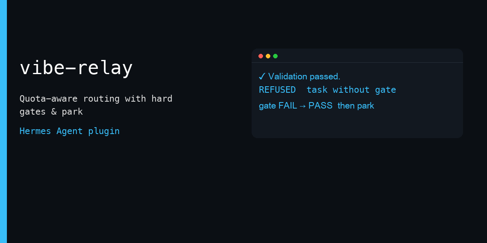
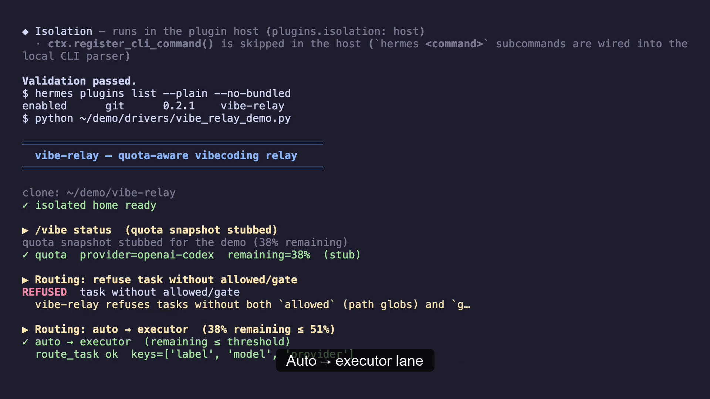

# vibe-relay



[▶ Demo video (≈40 s)](assets/demo.mp4) — real tool handlers running in an isolated Hermes home.



Vibecoding without burning your best model: a Hermes delegation backend that routes coding work to yourself when quota remains, or to a cheap executor when it does not — and only counts work done after a green gate on the real diff, parking itself across usage-window resets.

## 30-second quickstart

```bash
# In an isolated Hermes home (hackathon / CI pattern)
export HERMES_HOME=/path/to/isolated/home
hermes plugins install /path/to/vibe-relay
hermes config set delegation.backend vibe-relay
hermes config set delegation.backends.vibe-relay.executor_provider openrouter
hermes config set delegation.backends.vibe-relay.executor_model google/gemini-2.5-flash
# optional: policy executor-always | auto (default); stop_used_percent 90
```

Then in a session:

```text
/delegation vibe-relay --now
/vibe
delegate_task with lane=auto, allowed="src/**,tests/**", gate="python -m unittest discover -s tests -v"
# when the window is nearly gone:
/vibe park .
```

## Demo script

See [docs/DEMO.md](docs/DEMO.md) for a &lt;90 s shot list.

## Tools / commands

| Surface | Name | Role |
|---|---|---|
| Delegation backend | `vibe-relay` | `lane` auto\|self\|executor; requires `allowed` + `gate` |
| Tool | `vibe_accept` | Changed paths ⊆ allowed + fresh gate PASS → ACCEPT/REJECT |
| Tool | `df_init` / `df_check` / `df_nav` | Vendored DEV Framework (df_check returns a terminal command) |
| Slash | `/vibe` | Quota, mode, last gate, pending park |
| Slash | `/vibe park` | Handoff + exactly one one-shot cron at reset+buffer |
| Blueprint | `resume-after-reset` | Manual catalog twin of the park resume job |
| Hooks | `pre_llm_call`, `api_request_error`, `post_tool_call`, `pre_verify`, `subagent_stop` | Quota context; observe exhaustion; capture gate; continue if no PASS |

## Configuration (`delegation.backends.vibe-relay`)

| Key | Default | Meaning |
|---|---|---|
| `policy` | `auto` | `auto` or `executor-always` |
| `self_remaining_threshold` | `51` | Remaining % above which `auto` stays on self |
| `stop_used_percent` | `90` | Used % that flags park |
| `executor_provider` / `executor_model` | — | Cheap executor route |
| `executor_profile` | — | Or run child as another Hermes profile |
| `park_buffer_seconds` | `120` | Delay after `reset_at` before resume cron |
| `quota_provider` | active model provider | Passed to `fetch_account_usage(..., read_only=True)` |

## Data & network disclosure

- **Network:** only through Hermes `agent.account_usage.fetch_account_usage(provider, read_only=True)` (at most once per 180 s, cached under plugin storage). No direct credential file reads, no xAI/grok-cli paths.
- **Reads outside plugin data:** acceptance runs read-only `git status` / `diff` / `ls-files` child processes on the working tree; optional handoff write under the target repo’s `docs/`.
- **Local child processes:** `df_init` runs the vendored DEV Framework installer as a local Python child process that writes framework files into the target repository the agent names. Template scripts copied into a target repo may call `git` (and `gh` for devlog visibility) only when the user or agent runs them.
- **Shell / approvals:** does not bypass approvals. `df_check` returns the gate command for the agent to run via `terminal`. Park creates a cron job through `cronjob_manage` (normal tool path). No YOLO / non-interactive shells.
- **Stored data:** `$HERMES_HOME/plugin-data/vibe-relay/state.json` (quota cache, last gate, pending park, last route).

## Collision with a standalone `dev-framework` plugin

If `dev-framework` is already enabled, tool names `df_init` / `df_check` / `df_nav` may already be registered. vibe-relay detects that and **skips** re-registration (log line), keeping the already-loaded handlers. Disable the standalone plugin to use this repo’s vendored copy (`df_check` returns a terminal command instead of executing gates in-process).

## Agent Workshop skill pack

Fourteen portable agent-engineering skills ship under `skills/` and register as
`vibe-relay:<name>` (opt-in via `skill_view`). See [`skills/INDEX.md`](skills/INDEX.md).

| Skill | When |
|---|---|
| `agent-build-debug-loop` | Building or debugging long-lived agents |
| `agent-architecture-audit` | Auditing agent layers before blaming the model |
| `agent-harness-design` | Designing tools, cron, or eval harnesses |
| `context-budget-audit` | Auditing context or token bloat |
| `memory-engineering` | Engineering memory or retrieval |
| `known-errors` | Reading or appending a known-errors registry |
| `frozen-working-tree-review` | Strict read-only review of a frozen tree |
| `product-aware-engineering-releases` | Safe release splitting + owner-facing updates |
| `subagent-driven-development` | Plans via reviewed subagent tasks |
| `agent-maintenance` | Maintaining a long-lived companion agent |
| `lean-executor-orchestration` | Delegating code once; accept a receipt |
| `agent-field-acceptance` | Field-first acceptance of agent work |
| `test-driven-development` | Minimal, risk-proportional evidence |
| `systematic-debugging` | Root cause before fixing |

Merged near-duplicates: iterative-retrieval → `memory-engineering`; eval-harness → `agent-harness-design`; owner-facing communication → `product-aware-engineering-releases`. DEV Framework skills (`df-*`) remain available alongside.

Credit: `test-driven-development`, `systematic-debugging`, and `subagent-driven-development` are condensed adaptations of the Hermes bundled skills of the same names, registered namespaced as `vibe-relay:<name>` so they do not collide.

## Evidence from daily use

Before this plugin existed, the author ran the same loop by hand for 15 days (23 Oct – 6 Nov 2026) across 113 Hermes sessions: about 80 cheap-executor launches (Cursor CLI), 85 `delegate_task` calls, 8 read-only review runs and 8 one-shot continuations armed at a quota reset. Vibe Relay turns that manual routine — route by remaining quota, demand allowed paths and a gate, accept only a fresh PASS, park and resume at reset — into a plugin. Counts are from assistant turns in the author's local session store; they describe the workflow, not plugin telemetry.

## Limitations

- Live executor quality and real provider quota endpoints need a signed-in profile (see `OPEN` in `RECEIPT.md`).
- `pre_verify` nudges the **parent** turn that edited code; subagent edits are observed via `subagent_stop` + gate capture on `terminal`.
- Cooperative workflow: path checks detect out-of-scope writes after the fact; they do not sandbox the executor.

## License

License: TBD by author
